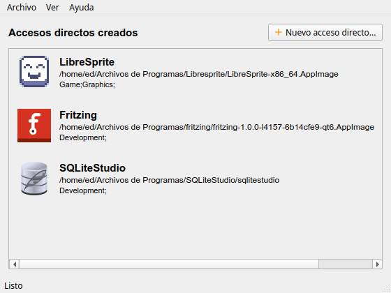
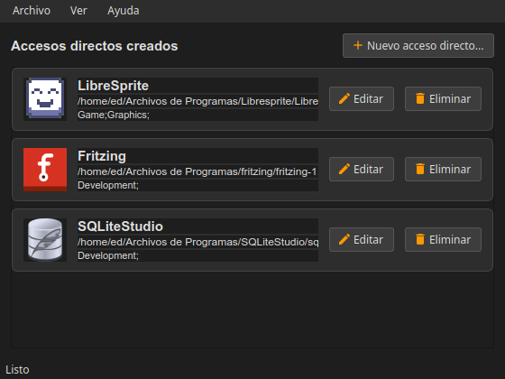
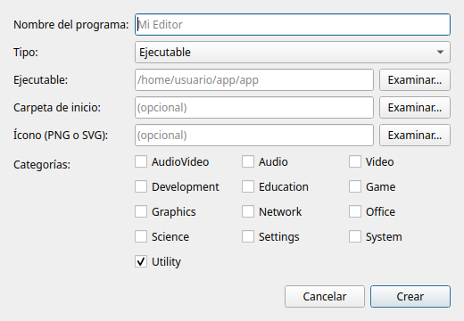
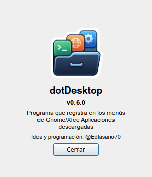

# dotDesktop

Aplicación de escritorio para registrar en los menús de **GNOME / Xfce** las
aplicaciones que descargas (normalmente binarios o AppImages), generando su archivo
`.desktop` en `~/.local/share/applications`.

Idea y programación: **@Edfasano70**

## Capturas

| Ventana principal | Modo oscuro |
| --- | --- |
|  |  |

| Nuevo acceso directo | Acerca de |
| --- | --- |
|  |  |

## Características

- Crea archivos `.desktop` con nombre, ejecutable, ícono y categorías.
- Interfaz gráfica en PyQt6, con selector de archivos y lista de categorías.
- Valida el ejecutable y avisa si no existe.
- Pregunta antes de sobrescribir un acceso directo existente.
- Escapa los campos según la especificación *Desktop Entry*.
- Refresca el menú con `update-desktop-database` si está disponible.
- Registra los accesos creados y los muestra como tarjetas en la pantalla principal.
- Permite editar los accesos creados (renombra el `.desktop` si cambia el nombre).
- Permite eliminar los accesos creados (borra el `.desktop` y su registro).
- Tema claro/oscuro y geometría de ventana persistentes.

## Requisitos

- Python 3.10 o superior
- PyQt6

## Instalación

No se usa entorno virtual. En Debian/Ubuntu, `--break-system-packages` es necesario
por la regla PEP 668:

```bash
python3 -m pip install --user --break-system-packages PyQt6
```

No hace falta instalar el proyecto: los comandos se ejecutan desde la raíz del repo.

## Uso

```bash
python main.py
```

En la ventana principal, usa **Archivo → Nuevo acceso directo...** (o el botón
**Nuevo acceso directo...**) e indica:

1. **Nombre del programa** — tal como aparecerá en el menú. Se completa solo al
   elegir el ejecutable, a partir de un `.desktop` existente o del nombre del archivo.
2. **Ejecutable** — ruta al binario o AppImage. Al elegirlo, dotDesktop intenta
   detectar el nombre y el ícono automáticamente (desde un `.desktop` existente,
   una imagen junto al ejecutable o el ícono interno del AppImage).
3. **Ícono** (opcional) — PNG o SVG; se completa solo si se detecta. Si no hay
   ícono, se usa el genérico del sistema (`application-x-executable`).
4. **Categorías** — una o varias casillas.

El acceso aparece listado como tarjeta y se puede **Editar** o **Eliminar** con sus botones.

## Estructura del proyecto

```
main.py                     # toda la aplicación (GUI, lógica .desktop, registro, main())
resources/
├── logo.png                # ícono de la aplicación y de "Acerca de"
├── logo.svg                # fuente editable del logo
└── icons/                  # íconos de menú en SVG
docs/screenshots/           # capturas para el README
packaging/
├── build_deb.sh            # compila con PyInstaller y genera el .deb
├── dotdesktop.desktop      # entrada de menú instalada
├── postinst / postrm       # scripts de mantenimiento del paquete
src/                        # vacío, reservado para módulos futuros
tests/                      # pytest
pyproject.toml              # ruff + pytest + metadatos
```

## Desarrollo

Instala las dependencias de desarrollo y ejecuta las comprobaciones:

```bash
python3 -m pip install --user --break-system-packages pytest ruff
pytest                       # suite completa
pytest tests/test_main.py::test_menus   # un solo test
ruff check .                 # lint
ruff format .                # formato
```

## Empaquetado (.deb)

Requiere `pyinstaller` y `dpkg-deb` (`dpkg-dev`):

```bash
python3 -m pip install --user --break-system-packages pyinstaller
./packaging/build_deb.sh
```

El script compila un binario autónomo con PyInstaller y genera
`packages/dotdesktop_<versión>_<arquitectura>.deb` (la carpeta `packages/` está
ignorada por git). El paquete instala la app en `/opt/dotdesktop`, crea
`/usr/bin/dotdesktop`, la entrada de menú en `/usr/share/applications` y el ícono en
`/usr/share/icons/hicolor`.

## Persistencia

- Preferencias (geometría de ventana y tema): `~/.config/dotdesktop/config.xml`.
- Registro de accesos creados por el programa: `~/.config/dotdesktop/launchers.json`.
- Íconos extraídos de AppImages: `~/.local/share/dotdesktop/icons/`.
- Archivos `.desktop`: `~/.local/share/applications`.
